[](https://www.microchip.com)

## Motor Control With AVR® Family

This repository features a motor control application designed for sinusoidal control, which includes two implementations based on the AVR family: AVR16EB32 and AVR128DA48. Check the [*Release Notes*](#release-notes) section to see the available functionality of the current release. The aim of this application is to maintain stability through a simplified Proportional-Integral (PI) algorithm. Sensored control using Hall sensors is supported. These two code examples have the same functionality; the only difference being the device used.

- <b>AVR EB</b> has two new peripherals: the Timer Counter type E (TCE) and the Waveform Extension (WEX), with new hardware capabilities designed to handle functions typically managed by software in motor control, as described in the [Getting Started with the TCE and WEX](https://onlinedocs.microchip.com/oxy/GUID-8FB8D192-E8C9-4748-B991-D4D842E01591-en-US-1/index.html) and in the [AVR® EB Data Sheet](https://www.microchip.com/en-us/product/avr16eb32#document-table)

- <b>AVR DA</b> provides increased memory, higher CPU frequency and additional pins, as described in the [AVR® DA Data Sheet](https://www.microchip.com/en-us/product/avr128da48#document-table)
  
The application is designed to obtain a sinusoidal drive with motor synchronization and support for sensored feedback type. The focus is on Brushless Direct Current (BLDC) and Permanent Magnet Synchronous (PMSMs) motors.

The sensored feedback and synchronization are achieved using the transitions from the Hall sensors, corresponding to each of the three phases of the motor. The transitions are captured by reading the Hall sensors pins. The motor synchronization is achieved using a PI algorithm, that calculates the error between the given stator angle and the acquired rotor angle.

<h2> Table of Contents </h2>

- [Motor Control With AVR® Family](#motor-control-with-avr-family)
- [Release Notes](#release-notes)
- [Related Documentation](#related-documentation)
- [Software Used](#software-used)
- [Hardware Used](#hardware-used)
- [Solution Diagram](#solution-diagram)
- [Quick Start Guide](#quick-start-guide)
  - [Physical Setup](#physical-setup)
  - [Curiosity Nano - MPPB Pin Mapping](#curiosity-nano---mppb-pin-mapping)
  - [Configuration Settings](#configuration-settings)
- [Application Usage](#application-usage)
  - [Let's Spin the Motor](#lets-spin-the-motor)
  - [Tunning Guide](#tunning-guide)
  - [Programming the AVR® MCU](#programming-the-avr-mcu)
  - [Console Interface](#console-interface)
  - [PWM Input Interface](#pwm-input-interface)
- [Software Description](#software-description)
  - [Software Organization in Folders and Files](#software-organization-in-folders-and-files)
  - [MCC Maping](#mcc-maping)
  - [Application Block Overview](#application-block-overview)
  - [Application Flowchart](#application-flowchart)
  - [Application Programming Interface Functions](#application-programming-interface-functions)
  - [Configurable Parameters](#configurable-parameters)
  - [Application Interrupt Window Time](#application-interrupt-window-time)
  - [Motor Sinusoidal Drive](#motor-sinusoidal-drive)
  - [Motor Feedback Sensing](#motor-feedback-sensing)
    - [Hall Sensing](#hall-sensing)
  - [Motor Synchronization Algorithm](#motor-synchronization-algorithm)
  - [Motor Speed Regulator Algorithm](#motor-speed-regulator-algorithm)
- [Results](#results)
- [Summary](#summary)

## Release Notes

Version 1.0.0 features:

- Support for three-phase BLDC and PMSM motors
- Motor specification in the configuration file
- Sinusoidal drive
- Support for the sensored control using Hall sensors
- Start ramp
- Support for changing the motor spinning direction at run-time, clockwise (CW) and counterclockwise (CCW)
- Proportional-Integral (PI) algorithm with fixed parameters for Open-Loop synchronization
- Speed regulator with adjustable Kp and Ki parameters for Closed-Loop control
- Fault support for hardware Peak Overcurrent Protection (Peak OCP), software Average Overcurrent Protection (Avg OCP), Overvoltage Protection (OVP) and Stall Detection
- Current, Voltage Bus and Potentiometer analog measurements at run-time
- PWM input for compatibility with radio-controlled receivers
- Switching frequency at 20 kHz

## Related Documentation

More details and code examples on the AVR16EB32 and AVR128DA48 can be found at the following links:

- [AVR<sup>®</sup> EB Product Page](https://www.microchip.com/en-us/products/microcontrollers/8-bit-mcus/avr-mcus/avr-eb)
- [AVR<sup>®</sup> EB Code Examples](https://mplab-discover.microchip.com/v2?dsl=avr16eb32)
- [AVR<sup>®</sup> DA Product Page](https://www.microchip.com/en-us/products/microcontrollers/8-bit-mcus/avr-mcus/avr-da)
- [AVR<sup>®</sup> DA Code Examples](https://mplab-discover.microchip.com/v2?dsl=avr128da48)

## Software Used

- [MPLAB® X IDE v6.30 or newer](https://www.microchip.com/en-us/tools-resources/develop/mplab-x-ide?utm_source=GitHub&utm_medium=TextLink&utm_campaign=MCU8_AVR-EB&utm_content=avr16eb32-bldc-pmsm-motor-control-library-github&utm_bu=MCU08)
- [AVR-Ex DFP v2.11.221 or newer](https://packs.download.microchip.com/)
- [AVR-Dx DFP v2.7.321 or newer](https://packs.download.microchip.com/)
- [MPLAB® XC8 compiler v3.10 or newer](https://www.microchip.com/en-us/tools-resources/develop/mplab-xc-compilers?utm_source=GitHub&utm_medium=TextLink&utm_campaign=MCU8_AVR-EB&utm_content=avr16eb32-bldc-pmsm-motor-control-library-github&utm_bu=MCU08)
- [MPLAB Code Configurator (MCC) v5.8.4 or newer](https://www.microchip.com/en-us/tools-resources/configure/mplab-code-configurator)

## Hardware Used

- [AVR<sup>®</sup> EB Curiosity Nano](https://www.microchip.com/en-us/development-tool/EV73J36A)
- [AVR<sup>®</sup> DA Curiosity Nano](https://www.microchip.com/en-us/development-tool/DM164151)
- [Multi-Phase Power Board (MPPB)](https://www.microchip.com/en-us/development-tool/EV35Z86A)
- [AVR EB Curiosity Nano Adaptor to MPPB](https://www.microchip.com/en-us/development-tool/EV88N31A)
- [AVR DA Curiosity Nano Adaptor to MPPB](#curiosity-nano---mppb-pin-mapping), made with wires
- A voltage power supply (6-55V and 10A limit, depending on the motor used)
- At least one BLDC motor
- For the development and testing of this demo, the following motors were used:
  - ACT42BLF01
  - ACT57BLF02
  - Hurst DMA0002024C1010
  - Hurst DMB2424B10002

## Solution Diagram

<br>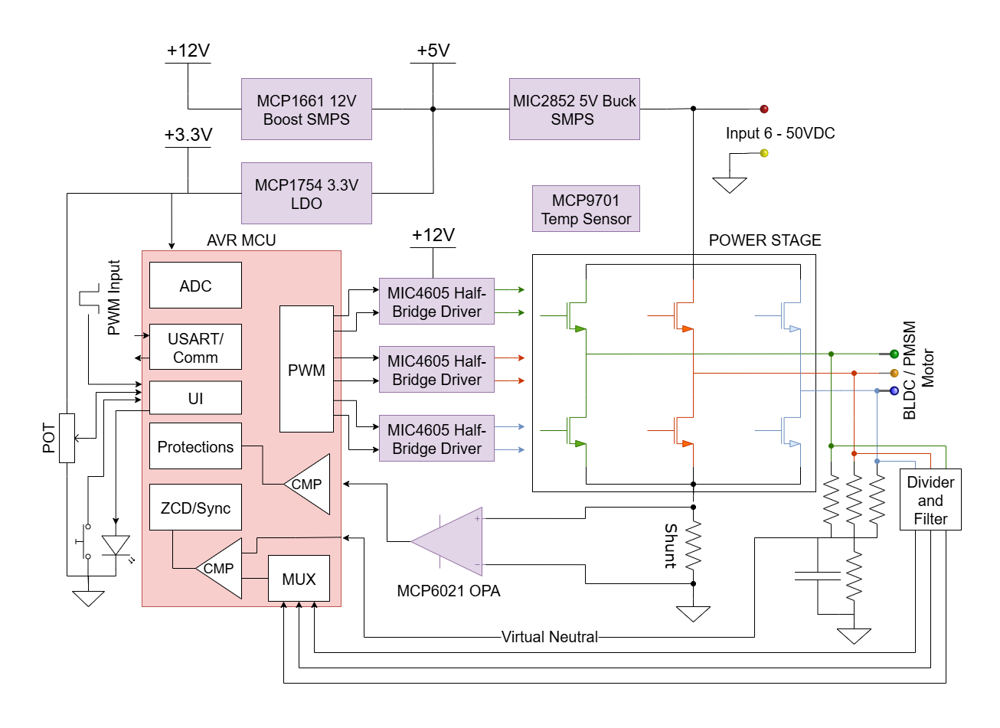

## Quick Start Guide

### Physical Setup

The AVR16EB32 or AVR128DA48 Curiosity Nano Development boards are used along with the MPPB, AVR EB or AVR DA CNANO to MPPB adapter board, the BLDC motor and a voltage power supply.

<br>Connection steps:

1. Plug in the AVR16EB32 or AVR128DA48 Curiosity Nano board in the connector present on the MPPB adapter board.
2. Plug in the MPPB adapter board to the MPPB board.
3. Plug in the AVR® EB or AVR DA Curiosity Nano boards to the PC.
4. Connect the voltage power supply wires to the V_SUPPLY conector from the MPPB.
5. Connect the motor phase wires to the PHASE connector from MPPB in order: A, B and C.
6. Connect the Hall sensors wires to the HALL SENSOR connector from MPPB (phase A with Hall A, phase B with Hall B and phase C with Hall C).

<br> <b>Note:</b> The order of Hall sensors wires must match the order of motor phases wires for the control algorithm to work. The A, B, and C wire connection succession is mandatory for both motor phases and Hall sensors.

<h4> Example Setup: </h4>

<br> 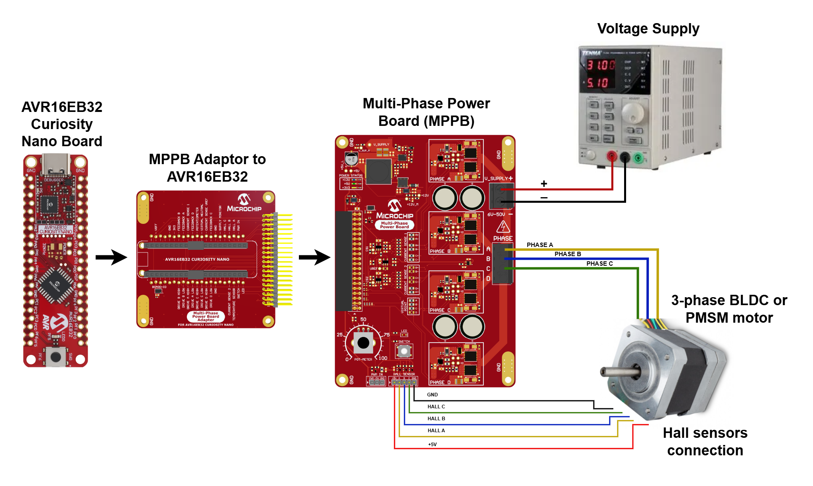 

### Curiosity Nano - MPPB Pin Mapping

If the MPPB and the adapter boards are not used, the user can integrate the AVR EB or AVR DA boards into another hardware setup by using the following pinouts:

| Curiosity Nano Boards Pinout                                              | Curiosity Nano - MPPB Pin Mapping                                        |
|:-------------------------------------------------------------------------:|:------------------------------------------------------------------------:|
| 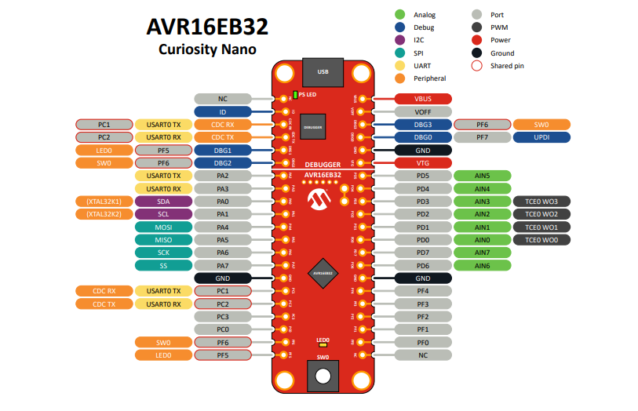                                   | 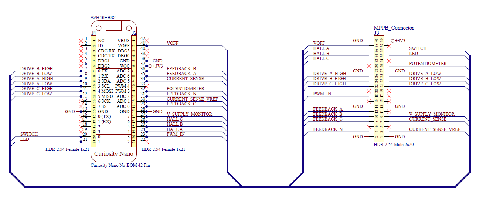                                   |
| 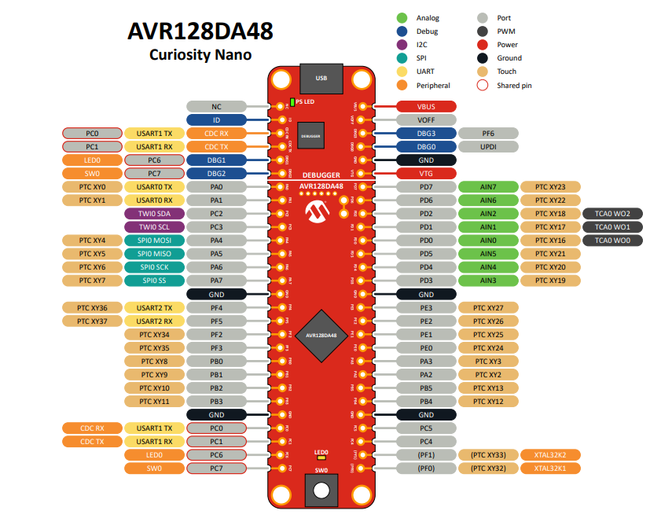                                   | 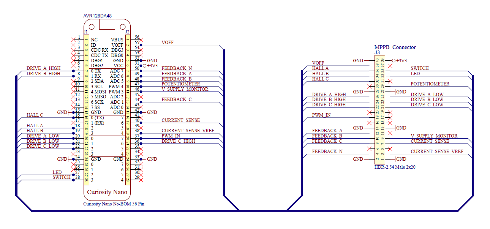                                   |

<h4> Pin mapping legend AVR16EB32 and AVR128DA48 Curiosity Nano Boards to MPPB </h4>

| Pin Name                      | AVR16EB32 Curiosity Nano Board | AVR128DA48 Curiosity Nano Board | MPPB Board                    |
|-------------------------------|--------------------------------|---------------------------------|-------------------------------|
|Drive A High                   |Pin 9  - PA0                    |Pin 7  - PA0                     |Pin 26                         |
|Drive A Low                    |Pin 10 - PA1                    |Pin 20 - PB0                     |Pin 25                         |
|Drive B High                   |Pin 7  - PA2                    |Pin 8 -  PA1                     |Pin 24                         |
|Drive B Low                    |Pin 8  - PA3                    |Pin 21 - PB1                     |Pin 23                         |
|Drive C High                   |Pin 11 - PA4                    |Pin 36 - PA2                     |Pin 22                         |
|Drive C Low                    |Pin 12 - PA5                    |Pin 22 - PB2                     |Pin 21                         |
|Feedback A                     |Pin 35 - PD4                    |Pin 49 - PD6                     |Pin 12                         |
|Feedback B                     |Pin 36 - PD5                    |Pin 48 - PD2                     |Pin 10                         |
|Feedback C                     |Pin 29 - PD6                    |Pin 44 - PD4                     |Pin 8                          |
|Feedback N                     |Pin 31 - PD0                    |Pin 50 - PD7                     |Pin 4                          |
|Current Sense                  |Pin 34 - PD3                    |Pin 40 - PE2                     |Pin 7                          |
|Current Sense V<sub>REF</sub>  |Pin 30 - PD7                    |Pin 38 - PE0                     |Pin 3                          |
|Current Trip                   |Pin 34 - PD3                    |Pin 40 - PE2                     | -                             |
|V Supply Monitor               |Pin 27 - PF4                    |Pin 46 - PD0                     |Pin 9                          |
|Potentiometer                  |Pin 32 - PD1                    |Pin 47 - PD1                     |Pin 29                         |
|LED                            |Pin 21 - PF5                    |Pin 27 - PC6                     |Pin 33                         |
|Switch                         |Pin 20 - PF6                    |Pin 28 - PC7                     |Pin 35                         |
|PWM IN                         |Pin 23 - PF0                    |Pin 37 - PA3                     |Pin 18                         |
|TXC                            |Pin 16 - PC1                    |Pin 25 - PC0                     | -                             |
|RXC                            |Pin 17 - PC2                    |Pin 26 - PC1                     | -                             |
|HALL A                         |Pin 24 - PF1                    |Pin 18 - PF2                     |Pin 36                         |
|HALL B                         |Pin 25 - PF2                    |Pin 19 - PF3                     |Pin 34                         |
|HALL C                         |Pin 26 - PF3                    |Pin 16 - PF4                     |Pin 32                         |
|3V3                            |Pin 37                          |Pin 51                           |Pin 39                         |
|V<sub>OFF</sub>                |Pin 41                          |Pin 55                           |Pin 38                         |
|GND                            |Pins: 38, 28, 15                |Pins: 52, 42, 33, 24, 15         |Pins: 40, 28, 27, 14, 13, 2, 1 |

<br><b>Note:</b> In this repository, schematics for all the two platforms are provided in the `pdf` folder:
 - AVR16EB32_MPPB_Mapping
 - AVR128DA48_MPPB_Mapping
</br>

### Configuration Settings

<br>The following configuration settings (apart from the default values) are needed to run the demo in the Sinusoidal Sensored mode with the ACT57BLF02 motor.
<br>Edit the settings in the [`config.h`](#configurable-parameters) configuration file according to the usage scenario.

<br><h3> ACT57BLF02 Motor Configuration Settings </h3>

```c

/* Analog module settings */
#define ADC_IIR_FILTER                  true         /* Smoothing filter on ADC functions: POT, VBUS, current */

/* PWM-In settings */
#define PWM_IN_PERIOD                   (20.0)       /* ms */
#define PWM_IN_MAX_DCY                  ( 2.0)       /* ms */
#define PWM_IN_MIN_DCY                  ( 1.0)       /* ms */

/* Board specific settings - MPPB */
#define CURRENT_SHUNT_RESISTANCE        (0.01)       /* Resistance in ohm of the current shunt */
#define CURRENT_AMPLIFIER_GAIN          (7.5)
#define VBUS_DIVIDER                    (16.0)
#define ANALOG_REFERENCE                (3300.0)     /* mV */
#define ADC_VBUS_TRIP                   (51000.0)    /* mV - VBUS trip level */
#define ADC_CURRENT_TRIP                (10000.0)    /* mA - ADC current trip level */
#define COMPARATOR_CURRENT_TRIP         (22000.0)    /* mA - Comparator trip level - not used on external-comparator configurations */
#define FAULT_COMPARATOR_EN             true
#define BOARD_MOSFET_RDSON              (0.004)      /* ohm - MOSFETs Rds-on resistance */

/* Motor-specific settings */
/* ACT57BLF02:  supply 24V, 3A limit */
#define MOTOR_STARTUP_CURRENT           (11000.0)    /* mA - Initial alignment current pulse may be higher than overcurrent protection */
#define MOTOR_RPP                       (0.45)       /* ohms - Motor resistance measured phase-to-phase */
#define MOTOR_ALIGNMENT_DURATION        (50)         /* ms */
#define MOTOR_STARTUP_TIME              (1000)       /* ms -  Delay until commands (POT or PWM-in) are accepted; '-1' makes commands to be ignored */
#define MOTOR_STARTUP_SPEED             (3000.0)     /* e-RPM - Specify the initial speed - minimum value is 120 e-RPM*/
#define HALL_ENABLED                    true         /* Setting to 'true' enables the Hall synchronization, while setting to 'false' enables the BEMF synchronization */
#define HALL_MISALIGNMENT_CW            (9.0)        /* Hall misalignment 0.0 ... 30.0 electrical degrees */
#define HALL_MISALIGNMENT_CCW           (7.0)        /* Hall misalignment 0.0 ... 30.0 electrical degrees */
#define HALL_INVERTED                   false        /* Sets the Hall pins polarity - 'true' for sensors active in '0' and 'false' for sensors active in '1' */ 

/* Speed regulation specific settings */
#define REGULATOR_SPEED_EN              true         /* Setting to 'true' enables speed control in Closed Loop, setting to 'false' enables amplitude control in Open Loop */
#define REGULATOR_MAX_SPEED             (12000.0)    /* e-RPM target speed for 100% command */
#define REGULATOR_MIN_SPEED             (4000.0)     /* e-RPM target speed for   0% command */
#define REGULATOR_PI_KI                 (4.0)        /* PI speed control loop integral coefficient, minimum 1.0 */
#define REGULATOR_PI_KP                 (8.0)        /* PI speed control loop proportional coefficient, minimum 1.0 */

/* Drive Algorithm settings */
#define DRIVE_FORCED                    false        /* Setting to 'true' runs the motor without BEMF sensing, only blind drive and no rotor synchronization, which could overheat the motor */
#define STALL_DETECTION_THRESHOLD       (10)         /* Stall detection tolerance: higher number - more tolerant to perturbances, but slower detection */
#define STALL_DETECTION_ENABLED         true         /* Setting to 'false' disables the stall detection mechanism */
#define STALL_MAXIMUM_ERPM              (50000.0)    /* e-RPM - Threshold when the algorithm might lose synchronization */
```

<br><b>Note:</b> In the `config_examples` folder, there are `config.h` example files, one for each motor used in testing this demo. Copy the variant of the `config.h` file corresponding to the desired motor and place it in `fw/common_files`. The copied configuration file will overwrite the old one.</br>

## Application Usage

### Let's Spin the Motor

After all the steps from [Quick Start Guide](#quick-start-guide) are completed, turn the MPPB potentiometer to 50%, then press the MPPB button to spin the motor.
The spinning direction depends on the wiring of the phases.

### Tunning Guide

If the motor is not yet spining after following all the steps in [Quick Start Guide](#quick-start-guide), or an error message appears on the console, the steps below can help tunning the application for a new motor:

1. Measure the phase-to-phase resistance between any two wires of the motor. Put this value in `MOTOR_RPP`, from the `config.h` file.
2. Disable the speed regulator by setting `REGULATOR_SPEED_EN` to `false`.
3. The initial value for `MOTOR_STARTUP_CURRENT` can be close to the rated current of the motor.
4. If the motor is not spinning after the first two steps and reprogramming, set `MOTOR_STARTUP_TIME` to `-1` and `DRIVE_FORCED` to `true`, to put the motor in Forced Commutation mode. Try to increase `MOTOR_STARTUP_CURRENT` by 0.5A and reprogram until the motor starts spinning. After the motor is spinning in Forced mode without vibrations, set `MOTOR_STARTUP_TIME` to the initial value and `MOTOR_FORCED` back to `false`.
5. `MOTOR_ALIGNMENT_DURATION` can also be adjusted. For example, for a motor with lower inductance, the alignment period is much smaller compared to a motor with higher inductance. Try to increase or decrease the duration with steps not greater than 10 ms at a time.
6. After getting the motor to spin, set the`REGULATOR_SPEED_EN` parameter back to `true`.
7. For stability, ensure that `REGULATOR_MIN_SPEED` is high enough to run the motor stable (10% of nominal speed) and that `REGULATOR_MAX_SPEED` does not exceed the maximum rated speed at the supplied voltage.
8. For sensored control, set the `HALL_ENABLED` parameter to `true`; start with initial `HALL_MISALIGNMENT_CW` and `HALL_MISALIGNMENT_CCW` to 0 electrical degrees and set `HALL_INVERTED` to `false`. If the motor spins eratically, consumes a lot of current or enters a Stall condition, try to increase `HALL_MISALIGNMENT_CW` and `HALL_MISALIGNMENT_CCW` with one electrical degrees at a time and run again. The values of hall misalignment for CW and CCW spinning direction might not be the same. If the motor is still not spinning, try setting the `HALL_INVERTED` parameter to `true` and repeat. Compare the achieved speed and current consumption with the ones rated for the supplied voltage. If the results are the same, the motor is tuned to use Hall sensors.

### Programming the AVR® MCU

1. Download the `.zip` file or clone the repository to get the source code.

2. Open the `fw/motor_demo_eb.X` or  `fw/motor_demo_da.X` project in MPLAB® X IDE.

3. Right click the project and select Set as Main Project.

<br>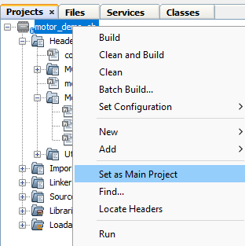

4. Edit the [`config.h`](#configurable-parameters) file, found in `common_files` folder, with the utilized motor parameters and drive options. See [Configuration Settings](#configuration-settings) for examples.

5. Build the `motor_demo_eb.X` or `motor_demo_da.X` project by clicking **Clean and Build Project**.

<br>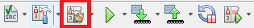

6. Click **Make and Program Device** to program the project to the board.

<br>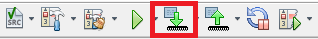

### Console Interface

<br>The application has a console communication interface. To activate it, open a PC software terminal and select the UART protocol, 8N1, with a baud rate of 57600 bps.
<br> The serial interface provides information about the remote controller PWM input, potentiometer value, voltage bus value, motor current value, electrical rotations per minute (RPM) value and motor running state (ON/OFF).

<br>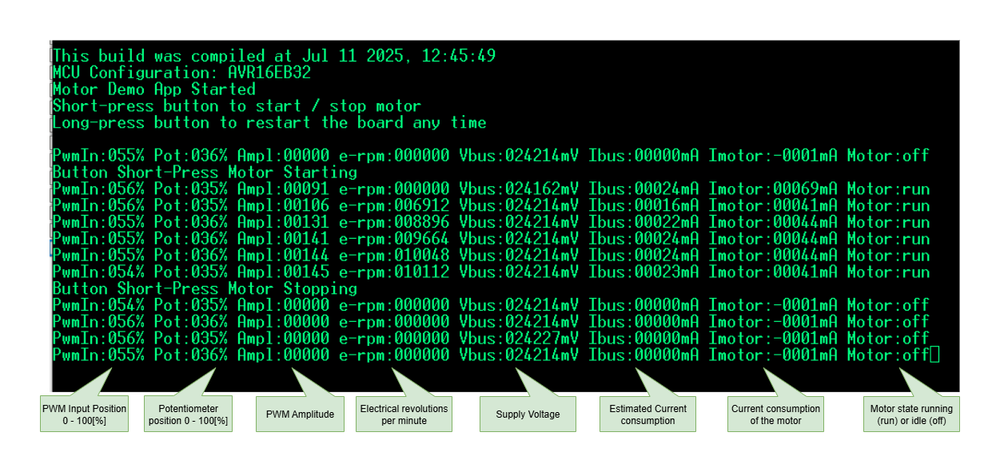

### PWM Input Interface
<br>The MPPB hardware and the software application support interfacing with a PWM Remote Controller (PWM-RC).
<br>The application measures both signal from the PWM-RC and on-board potentiometer, but the PWM-RC has priority over the potentiometer in controlling the motor.
<br>If the PWM-RC/PWM-IN signal is not detected, then the on-board potentiometer is used for control.
<br>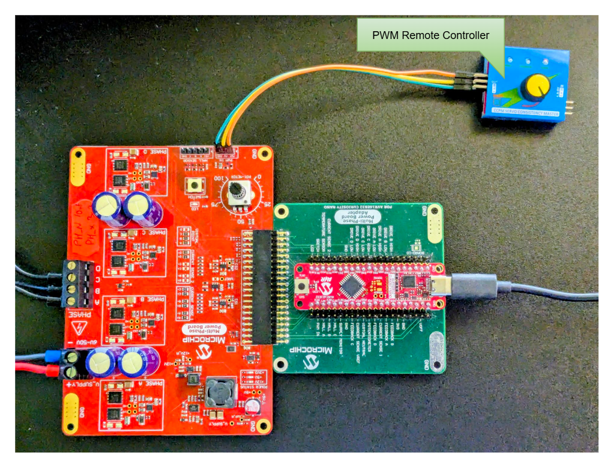

## Software Description

### Software Organization in Folders and Files

All the files shared by the three platforms are in the `common_files` folder. Each platform has its own `main.c` and `mcc_mapping.h` files.
```
   fw
    ├───common_files
    │   │   app.c
    │   │   config.h
    │   │
    │   ├───motor
    │   │       analog.c
    │   │       analog.h
    │   │       conversion_macros.h
    │   │       motor.c
    │   │       motor.h
    │   │
    │   └───utils
    │           button_led.c
    │           button_led.h
    │           dbg_logger.c
    │           dbg_logger.h
    │           dbg_pins.h
    │           precise_delay.h
    │           pwm_in.c
    │           pwm_in.h
    │           sw_timer.c
    │           sw_timer.h
    │           frac-lib.h
    │           frac-lib.s
    │
    ├───motor_demo_da.X
    │   │   main.c
    │   │   Makefile
    │   │   mcc_mapping.h
    │   │   motor_demo_da.mc3
    │   │   util_da.s
    │   │
    │   ├───mcc_generated_files
    │   └───nbproject
    │           configurations.xml
    │           project.xml
    │
    ├───motor_demo_eb.X
        │   main.c
        │   Makefile
        │   mcc_mapping.h
        │   motor_demo_eb.mc3
        │
        ├───mcc_generated_files
        └───nbproject
                configurations.xml
                project.xml
  
```

### MCC Maping

The `mcc_mapping.h` files are used to map all the port pins and low-level driver functions generated using the MPLAB® Code Configurator (MCC) to the abstract layers of the application. These layers include: motor, analog, LED/button, PWM-IN and other wrapper layers. The `mcc_mapping.h` files can be found in `fw/motor_demo_eb.X` and `fw/motor_demo_da.X`.

### Application Block Overview

<br>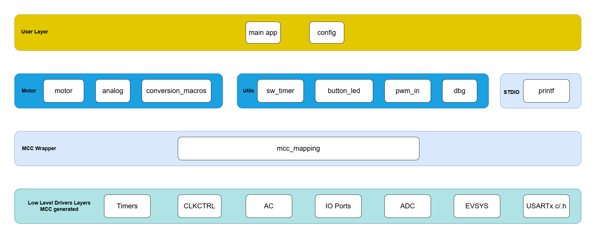

### Application Flowchart

<br>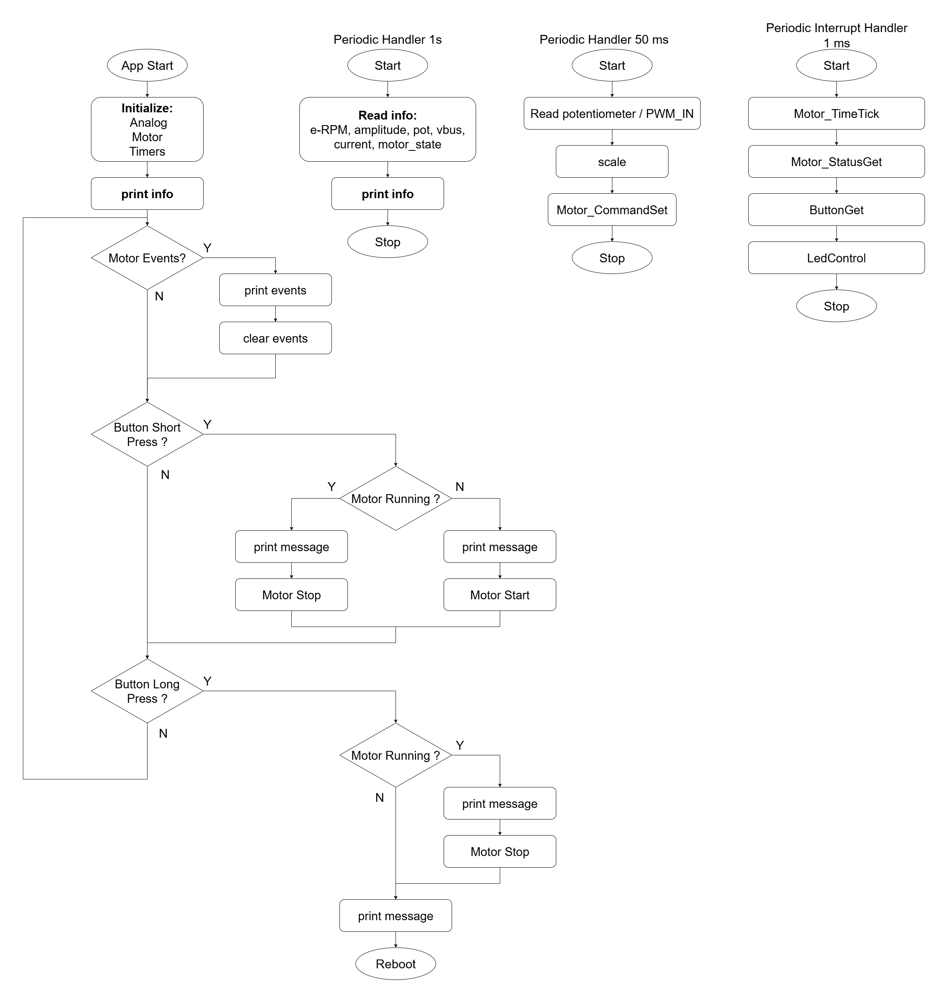

1. Short press the button on the MPPB board. The motor starts spinning in CW direction and enters the Running state. The LED from MPPB turns on. The speed can be adjusted using the potentiometer present on the MPPB board or through an external PWM-RC.
2. Short press the button from MPPB again. The motor decelerates, comes to a complete stop and enters the Idle state. The LED from MPPB turns off.
3. Short press the button on the MPPB board. The motor starts spinning in CCW direction and enters the Running state. The LED from MPPB turns on. The speed can be adjusted using the potentiometer present on the MPPB board or through an external PWM-RC.
4. Short press the button from MPPB again. The motor decelerates, comes to a complete stop and enters the Idle state. The LED from MPPB turns off.
5. Long press the button (more than 1.5s) to restart the application.
6. If a Fault event occurs, the motor stops, the event is mentioned on the console and the application enters the Idle state. The LED blinks five times signaling the error and stops afterwards.

### Application Programming Interface Functions

<br> The APIs from the Motor Control Stack found in `motor_control.h` are the following:

<br>• <b>`Motor_Initialize()`</b> - Initialization function, needs to be called before any other function
<br>• <b>`Motor_Start()`</b> - Starts the motor and sets the motor spinning direction. If the motor is already spinning, the call is ignored.
<br>• <b>`Motor_Stop()`</b> - Stops the motor. If the motor is already stopped, the call is ignored.
<br>• <b>`Motor_Fault()`</b> - Stops the motor and then clears the Fault flags. It is registered in the application to be called by the Analog module in case of a fault situation.
<br>• <b>`Motor_CommandSet()`</b> - Has dual use. For speed regulation mode it receives the value of the target speed. For open-loop mode it receives the value of the drive amplitude (PWM duty cycle).
<br>• <b>`Motor_MaxAmpGet()`</b> - Returns the maximum possible PWM amplitude value
<br>• <b>`Motor_StatusGet()`</b> - Returns the ON/OFF state of the motor and possible fault events
<br>• <b>`Motor_ErpmGet()`</b> - Returns the electrical RPM value of the motor during run-time
<br>• <b>`Motor_AmplitudeGet()`</b> - Gets the PWM amplitude value
<br>• <b>`Motor_TimeTick()`</b> - Needs to be called once every 1 ms, only in the context of an interrupt. It is required for internal synchronization.

<b>Important:</b> Use only the public APIs from the `motor_control.h` file so as not to alter the library functionality in any way.

### Configurable Parameters

The parameters from the `config.h` file used to customize the application are the following:

<br><b> Analog Module Settings </b>

<br>• <b>`ADC_IIR_FILTER`</b> - Enables or disables a smoothing filter for analog measurements: potentiometer, voltage bus and current. This filter is used only for displaying values, and not by fault or any other mechanism that requires a fast response.

<br><b> PWM Input Settings </b>

<br>• <b>`PWM_IN_PERIOD`</b> - Represents the period of the PWM input signal, compatible with radio-controlled receivers, that can be used to set the speed reference in Closed-Loop, or the PWM amplitude reference in Open-Loop. The standard value of this parameter in 20 ms.
<br>• <b>`PWM_IN_MAX_DCY`</b> - Represents the maximum `ON` time of the PWM input signal and is equivalent to setting the maximum reference. The standard value of this parameter is 2 ms, but it can be tuned accordingly to eventual tolerances.
<br>• <b>`PWM_IN_MIN_DCY`</b> - Represents the minimum `ON` time of the PWM input signal and is equivalent to setting the minimum reference. The standard value of this parameter is 1 ms, but it can be tuned accordingly to eventual tolerances.

<br><b> Power Board Settings </b>

<br>• <b>`CURRENT_SHUNT_RESISTANCE`</b> - The current sense shunt resistance, given in ohms, dependent on the power board
<br>• <b>`CURRENT_AMPLIFIER_GAIN`</b> - The current sense amplifier, dependent on the power board
<br>• <b>`VBUS_DIVIDER`</b> - The voltage divider, used to scale the V<sub>BUS</sub> to be able to measure it with the `ANALOG_REFERENCE` logic, dependent on the power board
<br>• <b>`ANALOG_REFERENCE`</b> - The voltage reference (this application has a 3V3 logic)
<br>• <b>`ADC_VBUS_TRIP`</b> - Sets the ADC trip level in case of an overvoltage protection, expressed in millivolts
<br>• <b>`ADC_CURRENT_TRIP`</b> - Sets the ADC trip level in case of an average overcurrent protection, expressed in milliamperes
<br>• <b>`COMPARATOR_CURRENT_TRIP`</b> - Sets the internal comparator's trip level in case of a peak overcurrent protection
<br>• <b>`FAULT_COMPARATOR_EN`</b> - Enables or disables the comparator used for current trip. For AVR16EB32 and AVR128DA48, this mechanism is implemented using an internal comparator.
<br>• <b>`BOARD_PHASE_RC_DELAY`</b> - Delay added to the BEMF Zero-Cross Detection (ZCD) by the RC filter present on the power board
<br>• <b>`BOARD_MOSFET_RDSON`</b> - The drain-source on-resistance value of the transistors present on the power board. This value is acquired from the data sheet of the transistor.

<br><b> Motor Settings </b>

<br>• <b>`MOTOR_STARTUP_CURRENT`</b> - The amount of current supplied to the motor phases during the start-up phase, given in amperes
<br>• <b>`MOTOR_RPP`</b> - Motor resistance measured phase-to-phase
<br>• <b>`MOTOR_ALIGNMENT_DURATION`</b> - Initial alignment duration before start-up
<br>• <b>`MOTOR_STARTUP_TIME`</b> - Represents the waiting time until the value from the `Motor_CommandSet()` is used to set the amplitude or reference speed. If this parameter is set to '-1', the value written by `Motor_CommandSet()` is ignored.
<br>• <b>`MOTOR_STARTUP_SPEED`</b> - Sets the initial speed for start-up. The minimum value is 120 e-RPM, but faster motors with low inductance need a bigger initial speed, with values of thousands of electrical RPMs.
<br>• <b>`HALL_ENABLED`</b> - Enables or disables the sensored control. If the sensored control is disabled, the sensorless control is enabled and vice-versa. The application does not support both sensored and sensorless control at the same time.
<br>• <b>`HALL_MISALIGNMENT_CW`</b> - This parameter is used to compensate the errors in CW spinning direction, because the sensors transitions are imperfect, due to mechanical placing. Its values can range between 0 and 30 electrical degrees.
<br>• <b>`HALL_MISALIGNMENT_CCW`</b> - This parameter is used to compensate the errors in CCW spinning direction, because the sensors transitions are imperfect, due to mechanical placing. Its values can range between 0 and 30 electrical degrees.
<br>• <b>`HALL_INVERTED`</b> - Used to invert hall pins polarity, if needed. Some hall sensors are active in `1` logic, while others are active in `0` logic.

<br><b> Speed Regulator Settings </b>

<br>• <b>`MOTOR_SPEED_REGULATOR_EN`</b> - Enables or disables the closed-loop speed regulator
<br>• <b>`REGULATOR_MAX_SPEED`</b> - Sets the maximum speed for the speed regulator
<br>• <b>`REGULATOR_MIN_SPEED`</b> - Sets the minimum speed for the speed regulator
<br>• <b>`REGULATOR_PI_KP`</b> - Proportional term constant parameter used by the speed regulator. It can have values between 0.0 and 1.0. Tune this in accordance with the used motor.
<br>• <b>`REGULATOR_PI_KI`</b> - Integral term constant parameter used by the speed regulator. It can have values between 0.0 and 1.0. Tune this in accordance with the used motor.

<br><b> Drive Algorithm Settings </b>

<br>• <b>`DRIVE_FORCED`</b> - Setting this parameter to `true` enables only forced commutation. Setting it to `false` enables motor synchronization.
<br>• <b>`STALL_DETECTION_THRESHOLD`</b> - The number of reached stall conditions until the motor is stopped. It can take values between 0 and 255.
<br>• <b>`STALL_DETECTION_ENABLED`</b> - Enables or disables the stall detection mechanism
<br>• <b>`STALL_MAXIMUM_ERPM`</b> - Speed value limit of the motor given in electrical RPM, when the algorithm might lose synchronization

<br> If the initial values are maintained, the motor will operate but performance may not be optimal. However, the settings above provide a good starting point for further tuning to meet the requirements of a custom application.

### Application Interrupt Window Time

<br>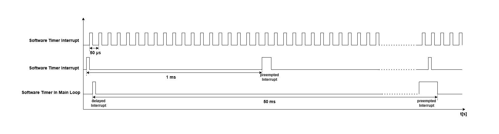

Interrupts (ISRs) used by the application:

1. Software timer interrupt - 50-μs (handles drive, feedback measurement and motor synchronization).
2. Software timer interrupt - 1-ms period (handles speed regulator, open loop controller, analog measurements, button and LED states).
3. Software timer in main loop - 50-ms period (handles reference commands scaling, amplitude in open-loop and speed in closed-loop, received from the potentiometer or external PWM input).

The table below presents the duration of each ISR or loop in the aplication:

| MCU and XC8 Options | 50 μs ISR [μs]        | 1 ms ISR [μs] | 50 ms Software Timer [μs] | Speed Regulator Loop [μs]   |
|:-------------------:|:---------------------:|:-------------:|:-------------------------:|:---------------------------:|
|AVR16EB32 FREE       |    10.5               |   23          |   45                      |   5.5                       |
|AVR16EB32 PRO        |    9                  |   20          |   36                      |   5                         |
|AVR128DA48 FREE      |    13.5               |   17          |   38                      |   4                         |
|AVR128DA48 PRO       |    12.5               |   14          |   30                      |   4                         |

<br> <b>Notes:</b>

1. FREE refers to the default optimization of the XC8 compiler version, available without license. PRO refers to the speed-optimized XC8 compiler version, available with license.

2. The 50-μs timer interrupt has a higher priority and will preempt running other interrupts, increasing their overall execution time, or will delay other interrupts.

### Motor Sinusoidal Drive

The Drive algorithm generates the six PWM signals that are used to drive the motor. For Sinusoidal drive, all three motor phases are constantly driven. There are never floating phases. One sine wave period represents 360 electrical degrees and the sine wave signals for the three phases are generated using a precalculated LUT, to be able to emulate sinusoidal signals by modulating the PWM signals. The frequency of the sine waves increases or decreases based on the motors' imposed speed.

The values from the LUT are scaled based on the desired amplitude. The three phases have a phase delay of 120 electrical degrees between each other all the time. At initialization, the first phase starts from 0 electrical degrees, the second one starts from 120 electrical degrees and the third one starts from 240 electrical degrees.
The sine wave signals frequency increases if the speed of the motor is increased and decreases if the speed of the motor is decreased. The amplitude of the sine wave is changed by modulating the duty cycles of the PWM signals. AVR EB can change the amplitude of the sine wave signals in hardware by just changing the values written in a few registers without the need to recalculate the values from the LUT and add extra mathematical computation that adds to the CPU overhead. AVR DA compensates the hardware capabilities of AVR EB in software, with more CPU capabilities.

Example of sinusoidal signal generated using PWM duty cycle signal modulation:
<br>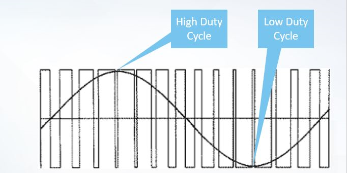

Example of controlling the amplitude of the sinewave with PWM duty cycle modulation:
<br>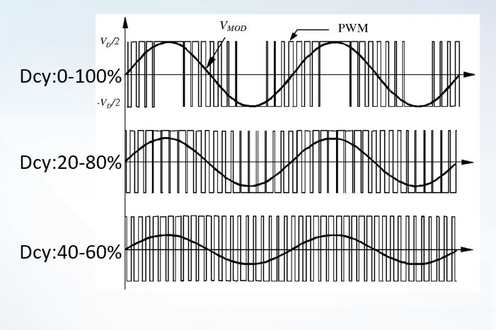

This application uses a Saddle profile of PWM modulation, because it offers higher DC-link voltage utilization (approx. 15.5% more) and lower Total Harmonic Distortion (THD) compared to plain sinusoidal PWM. Saddle PWM improves efficiency and reduces switching losses by leaving one leg of the inverter in a constant switching state, effectively reducing overall commutations.
Saddle PWM is generated by adding a third-harmonic to a standard sine wave and comparing this modified reference signal to a high-frequency triangle carrier wave. This process flattens the peaks of the modulating wave, reducing switching losses in 3-phase.

Example of the average voltage generated for one phase of the motor:
<br>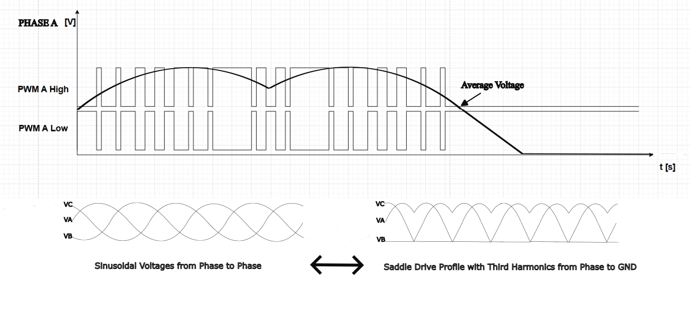

<br><b>Important:</b> Even if the Phase Voltages compared to GND are not sinusoidal, the difference between any two Phase Voltages is sinusoidal, Also, all the currents generated in the motor windings are sinusoidal.

<br>

### Motor Feedback Sensing

<br>

#### Hall Sensing

<br> The estimation of the rotor position in the Sinusoidal Sensored-Control mode is done by monitoring the Hall sensors signals. The transitions from the sensors during the rotor magnet passing by decides when 60° (electrical degrees) have passed during an electrical revolution of 360° (electrical degrees). Usually, the Hall sensors are in groups of three, placed inside the motor, with each sensor being 120° apart one from another.

<h4> Reading Hall Signals </h4>

| Phase Signals                                | Hall Signals                        |
|:--------------------------------------------:|:-----------------------------------:|
| 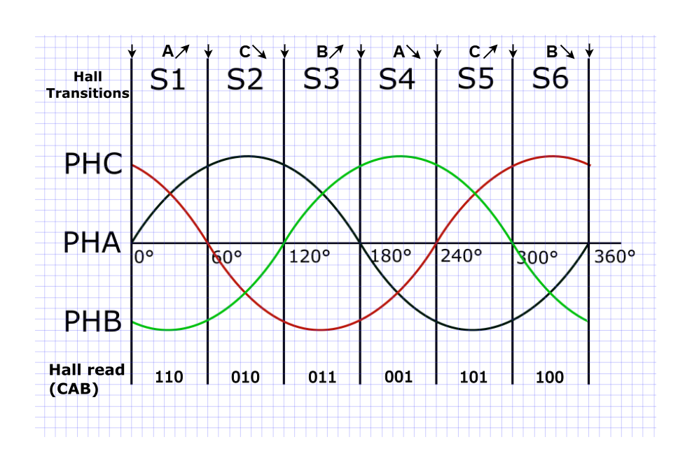 | 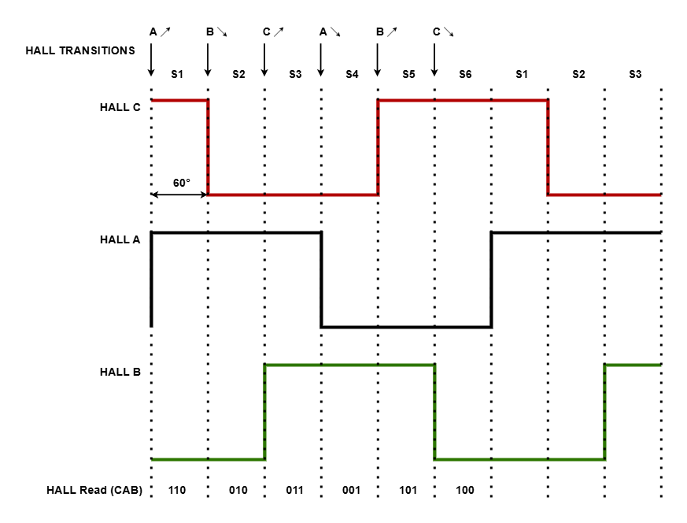 |

The data from Hall sensors is acquired using three General Purpose Input Output (GPIO) pins. The three pins are set as inputs to the HALL sensors and are sampled periodically during an interrupt window and compared to the previous value to detect a new transition.

<br> <b>Note:</b> Plain sine wave voltage signals were used in the image above just for an easier understanding, in reallity, saddle wave signals are used.

<h4> Hall Sensing Overview </h4>

<br>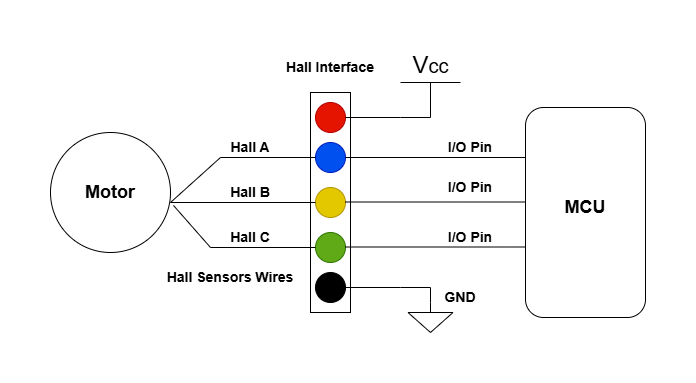

The sensored control allows to control the motor from 3% of the nominal speed and up to the maximum nominal speed. Below 3% of the nominal speed there is no guaranteed stability.

<br> <b>Note:</b> The AVR16EB32 and AVR128DA48 platforms can achieve the minimum rotational speed of 100 e-RPM.

### Motor Synchronization Algorithm

<br> The motor synchronization is achieved through a simplified Proportional Integral Derivative (PID) algorithm that calculates the error between the generated stator angle position, and the rotor angle position, acquired from Hall sensors data. The algorithm has only the proportional and the integral terms, but no derivative. The aim is to allign the position of the rotor with the position of the stator.
<br>The advantages of this algorithm relate to being based on bit-shifting operations and not adding too much CPU overload and interrupt time to process all the data. The speed oscillations are thus greatly reduced.

<h4> Synchronization Algorithm Timing </h4>

<br>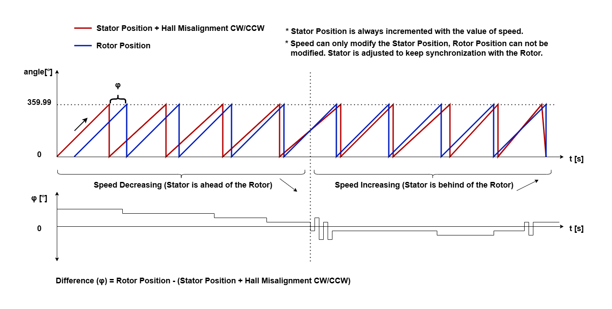

<br><b>Note:</b> The motor has the best efficiency when the phase voltages are aligned with the Hall signals. In theory the motor has the best efficiency when the current signals in the motor windings are alligned with the generated Back Electromotive Force (BEMF) signals, but in a sinusoidal drive the BEMF can not be measured directly.

<h4> Synchronization Algorithm Chart </h4>

<br>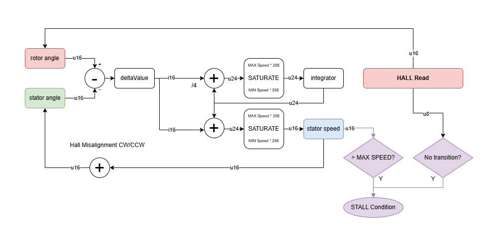

### Motor Speed Regulator Algorithm

<br> Speed regulation in Closed-Loop is achieved using a simplified PID algorithm that calculates the error between the target speed and measured speed. The algorithm only has the proportional and the integral terms, but no derivative. The target speed value is in the range between `REGULATOR_MIN_SPEED` and `REGULATOR_MAX_SPEED`. The measured speed is acquired by counting the sector change events during a fixed period of time. The values of `REGULATOR_PI_KP` and `REGULATOR_PI_KI` constants can be tuned to achieve a desired behaviour, depending on the specific motor being used. The values of the two constants must be positive.

<h4> Speed Regulator Algorithm Chart </h4>

<br>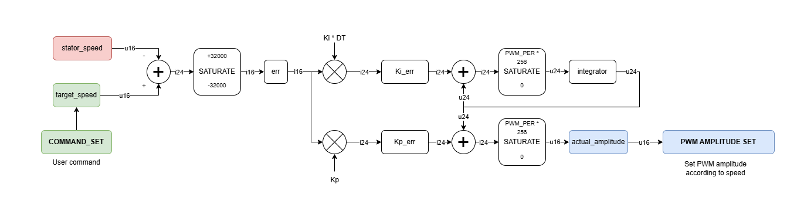

## Results

The images below present captures of the Hurst DMA0002024C1010 motor at full drive (maximum speed achieved at 100% duty cycle).<br>
Oscilloscope traces:

  * Ch 1 (Blue Trace) Phase A Current - current probe direction from the motor towards the board
  * Ch 2 (Cyan Trace) Phase A Voltage - referenced to ground
  * Ch 3 (Purple Trace) Hall A Signal   - referenced to ground

|      Mode           |Supply Voltage [V]| Current Consumption [A] | Duty Cycle [%] | e-RPM    |
|:-------------------:|:----------------:|:-----------------------:|:--------------:|:--------:|
|    **Full Drive**   |     24           |     0.26                |  100           | 20,000   |

<br>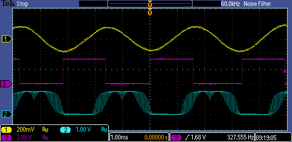

<br>Results obtained with various motors used in this project:

| Motor                 | Brief Specifications            | Supply Voltage [V] | Current Consumption [A] | e-RPM                    | Type    |
|:---------------------:|:-------------------------------:|:------------------:|:-----------------------:|:------------------------:|:-------:|
|ACT42BLF01             | 24 V / 1.9 A / 4 pp* / 4 kRPM   |    24              |      0.14  (no load)    |       12,000             | 3-phase |
|ACT57BLF02             | 24 V / 7.8 A / 4 pp / 3 kRPM    |    24              |      0.50  (no load)    |       12,000             | 3-phase |
|Hurst DMA0002024C1010  | 24 V / 4 A / 5 pp / 3 kRPM      |    24              |      0.12  (no load)    |       12,000             | 3-phase |
|Hurst DMB2424B10002    | 24 V / 7 A / 5 pp / 3 kRPM      |    24              |      0.2   (no load)    |       12,000             | 3-phase |

**Note:** *pp - stands for pole pairs

## Summary

<br>This project provides support for spinning a BLDC/PMSM motor using the Sinusoidal Drive method and feedback from Hall sensors to achieve motor synchronization in an Open-Loop configuration and speed control in a Closed-Loop configuration. The control algorithm is straightforward and robust and it can be implemented on a variety of low-end MCUs that have a few timer capabilities, with an AC and an ADC.
